# เอกสารขั้นตอนการทำงานของระบบปลดระวาง IOC (MISP IOC Retirement Workflow)

เอกสารนี้อธิบายสถาปัตยกรรมและขั้นตอนการทำงานของสคริปต์ [`misp_ioc_retirement.py`](file:///opt/misp-script/misp_ioc_retirement.py) ซึ่งใช้สำหรับบริหารจัดการวงจรชีวิต (Lifecycle Management) ของตัวบ่งชี้ภัยคุกคาม (Indicators of Compromise - IOCs) ในระบบ MISP แบบอัตโนมัติ

---

## 1. วัตถุประสงค์หลัก (Executive Summary)

* **ลดปัญหา False Positive และ Alert Fatigue:** ปิดการใช้งาน IOC ที่เก่าและไม่มีความเคลื่อนไหวแล้ว เพื่อไม่ให้ส่งผลกระทบต่อระบบตรวจจับปลายทาง (SIEM, EDR, Firewall, IDS)
* **Re-validation ด้วย Threat Intelligence:** ไม่ปลดระวาง IOC เพียงเพราะอายุเกิน แต่จะตรวจสอบซ้ำกับแหล่ง Threat Intelligence ภายนอกก่อนเสมอ
* **Safety-Fail Policy:** หากระบบตรวจสอบภายนอกขัดข้องหรือเกิด Timeout จะไม่ปลดระวาง IOC นั้นเด็ดขาด เพื่อความปลอดภัยสูงสุดของระบบตรวจจับ

---

## 2. แผนภาพขั้นตอนการทำงาน (Workflow Diagram)

```mermaid
flowchart TD
    subgraph Phase1 ["1. การเริ่มต้นและตรวจสอบสิทธิ์ (Initialization & Locking)"]
        Start(["เริ่มทำงาน (main)"]) --> CheckLock{"ตรวจสอบ Process Lock<br/>(/tmp/misp_ioc_retirement.lock)"}
        CheckLock -->|"มี process อื่นรันอยู่"| ExitLock(["จบการทำงานทันที (Exit)"])
        CheckLock -->|"ล็อกสำเร็จ"| LoadEnv["โหลดการตั้งค่าจาก .env"]
        LoadEnv --> LoadWL["โหลด Whitelist (.txt และ .env)"]
        LoadWL --> ConnectMISP{"เชื่อมต่อ MISP API"}
        ConnectMISP -->|"ล้มเหลว"| ExitErr(["บันทึก Error & จบการทำงาน"])
        ConnectMISP -->|"สำเร็จ"| FetchAttr["ดึง Attributes จาก MISP<br/>(จำกัด MAX_ATTRS_PER_RUN)"]
    end

    subgraph Phase2 ["2. การคัดกรองรายการหมดอายุ (Candidate Filtering)"]
        FetchAttr --> LoopAttr["วนลูปตรวจสอบทีละ Attribute"]
        LoopAttr --> CheckOrg{"orgc_id ตรงกับ<br/>OWNER_ORG_ID หรือไม่?"}
        CheckOrg -->|"ไม่ใช่"| SkipAttr["ข้าม (Skip)"]
        CheckOrg -->|"ใช่"| CheckToIds{"to_ids == True ?"}
        CheckToIds -->|"ไม่ใช่ (ปิดอยู่แล้ว)"| SkipAttr
        CheckToIds -->|"ใช่"| CheckWL{"อยู่ใน Whitelist<br/>หรือไม่?"}
        CheckWL -->|"อยู่ใน Whitelist"| AddCand["เพิ่มเข้าคิว Candidates"]
        CheckWL -->|"ไม่อยู่ใน Whitelist"| CheckAge{"คำนวณอายุ (วัน) > เกณฑ์กำหนด?<br/>- IP: > 30 วัน<br/>- Domain/URL: > 90 วัน<br/>- Hash: > 180 วัน"}
        CheckAge -->|"ไม่เกินเกณฑ์"| SkipAttr
        CheckAge -->|"เกินเกณฑ์ (Stale)"| AddCand
        SkipAttr --> NextAttr{"มี Attribute ถัดไป?"}
        AddCand --> NextAttr
        NextAttr -->|"มี"| LoopAttr
        NextAttr -->|"หมดแล้ว"| CheckCandCount{"มี Candidates<br/>หรือไม่?"}
        CheckCandCount -->|"ไม่มี (0 รายการ)"| DoneNoCand(["สิ้นสุดการทำงาน"])
        CheckCandCount -->|"มี (> 0)"| SortCand["เรียงลำดับ Candidates<br/>ตามอายุ (เก่าที่สุดขึ้นก่อน)"]
    end

    subgraph Phase3 ["3. ตรวจสอบความเคลื่อนไหว (Enrichment Re-validation)"]
        SortCand --> LoopCand["วนลูปประมวลผลทีละ Candidate"]
        LoopCand --> IsCandWL{"เป็นรายการจาก<br/>Whitelist หรือไม่?"}
        IsCandWL -->|"ใช่ (Whitelist)"| ForceRetire["กำหนด active = False ทันที"]
        IsCandWL -->|"ไม่ใช่"| CheckA{"1. ตรวจ Provider A API<br/>(IP, Domain, URL, SHA256)"}
        
        CheckA -->|"เสี่ยง (malicious_score > 0)"| ResActive["active = True"]
        CheckA -->|"Benign / 404 / Score=0 / ข้าม"| CheckB{"2. เป็น URL & มี Key ?<br/>ตรวจ Provider B API"}
        
        CheckB -->|"Status = online"| ResActive
        CheckB -->|"No results / ข้าม"| CheckMB{"3. เป็น Hash & มี Key ?<br/>ตรวจ Provider C API"}
        
        CheckMB -->|"Query status = ok"| ResActive
        CheckMB -->|"Hash not found / ข้าม"| CheckD{"4. ตรวจ Provider D<br/>(Fallback สำหรับทุกประเภท)"}
        
        CheckD -->|"พบ Pulse > 0"| ResActive
        CheckD -->|"Not found (404)"| ResInactive["active = False"]
        
        CheckA -->|"API Error / Timeout"| CheckB
        CheckB -->|"API Error"| CheckMB
        CheckMB -->|"API Error"| CheckD
        CheckD -->|"API Error"| CheckAllErr{"ทุก API เกิด Error<br/>ทั้งหมดหรือไม่?"}
        CheckAllErr -->|"ใช่ (Checked = 0)"| ResSafety["active = None<br/>(Safety-fail)"]
        CheckAllErr -->|"ไม่ใช่ (มีบาง API ระบุว่าไม่พบ)"| ResInactive
    end

    subgraph Phase4 ["4. การดำเนินการและสรุปผล (Action & Finalization)"]
        ResActive --> KeepActive["KEEP: ภัยคุกคามยังเคลื่อนไหว<br/>(คงสถานะเดิมไว้ใช้งานต่อ)"]
        ResSafety --> KeepSafety["KEEP: ระบบตรวจล้มเหลว<br/>(คงสถานะเดิมไว้เพื่อความปลอดภัย)"]
        
        ForceRetire --> ActionBranch
        ResInactive --> ActionBranch{"ผลตรวจ: ไม่พบความเคลื่อนไหว"}
        
        ActionBranch --> CheckDryRun{"DRY_RUN = True ?"}
        CheckDryRun -->|"ใช่ (Dry Run)"| LogDryRun["บันทึก Log เท่านั้น<br/>(ไม่มีการแก้ไขจริง)"]
        CheckDryRun -->|"ไม่ใช่ (ทำงานจริง)"| CheckWLAction{"เป็น Whitelist และ<br/>WHITELIST_ACTION = 'remove' ?"}
        
        CheckWLAction -->|"ใช่"| DeleteAttr["ลบ Attribute ออกจาก MISP<br/>(misp.delete_attribute)"]
        CheckWLAction -->|"ไม่ใช่"| DisableAttr["ปิดการใช้งาน (Soft-disable)<br/>ตั้งค่า to_ids = False"]
        
        DeleteAttr --> RecordEvent["เก็บ Event ID ลงรายการ<br/>events_to_publish"]
        DisableAttr --> RecordEvent
        
        KeepActive --> SleepDelay["หน่วงเวลา (API_DELAY = 0.3s)"]
        KeepSafety --> SleepDelay
        LogDryRun --> SleepDelay
        RecordEvent --> SleepDelay
        
        SleepDelay --> NextCand{"มี Candidate ถัดไป?"}
        NextCand -->|"มี"| LoopCand
        NextCand -->|"ครบแล้ว"| PublishCheck{"DRY_RUN = False และมี<br/>Event ที่ถูกแก้ไข ?"}
        
        PublishCheck -->|"ใช่"| PublishEvents["Republish Events ทั้งหมด<br/>(misp.publish, alert=False)"]
        PublishCheck -->|"ไม่ใช่"| Summary["แสดงสรุปผลและบันทึก Log File"]
        PublishEvents --> Summary
        Summary --> ReleaseLock["ปลด Process Lock"]
        ReleaseLock --> End(["สิ้นสุดการทำงาน"])
    end
```



---

## 3. เกณฑ์อายุของ IOC (Tiered Age Thresholds)

| หมวดหมู่ (Category) | Attribute Types ใน MISP | เกณฑ์อายุ (วัน) | เหตุผลในการกำหนดค่า |
| :--- | :--- | :---: | :--- |
| **IP** | `ip-src`, `ip-dst`, `ip-src\|port`, `ip-dst\|port` | **30 วัน** | IP มีการเปลี่ยนมือ (Churn rate) สูง เช่น Dynamic IP, Cloud IP |
| **Domain** | `domain`, `hostname`, `domain\|ip` | **90 วัน** | Domain ของผู้โจมตีมักถูก Takedown หรือทิ้งร้างหลังสิ้นสุดแคมเปญ |
| **URL** | `url`, `uri` | **90 วัน** | C2 URL หรือ Phishing Link มักมีอายุการใช้งานสั้น |
| **Hash** | `md5`, `sha1`, `sha256`, `sha512`, `filename\|...` | **180 วัน** | File Hash มีความคงทน ไม่เปลี่ยนแปลง แต่กำหนดอายุเพื่อลดภาระฐานข้อมูล |
| **ประเภทอื่นๆ** | อื่นๆ ที่ไม่เข้า 4 กลุ่มข้างต้น | **90 วัน** | ใช้ค่ามาตรฐานกลาง |

---

## 4. ลำดับการตรวจสอบ Threat Intelligence (Enrichment Hierarchy)

สคริปต์ใช้หลักการ **Short-Circuit Evaluation** คือ เรียงจากบริการที่เร็วที่สุดไปยังบริการสำรอง หากบริการใดตรวจพบว่ายังอันตราย จะหยุดตรวจบริการถัดไปทันที:

```
1. Provider A API (ตรวจ IP, Domain, URL, SHA256)
   └── หาก malicious_score > 0  ──> [KEEP]
   └── หาก Benign / 404 / Score=0  ──> ไปข้อ 2

2. Provider B API (ตรวจเฉพาะ URL)
   └── หาก status == 'online'  ──> [KEEP]
   └── หาก no_results  ──> ไปข้อ 3

3. Provider C API (ตรวจเฉพาะ File Hash)
   └── หาก query_status == 'ok'  ──> [KEEP]
   └── หาก hash_not_found  ──> ไปข้อ 4

4. Provider D API (แหล่งสำรองสากลสำหรับทุกประเภท)
   └── หาก pulse_count > 0  ──> [KEEP]
   └── หาก 404 / pulse_count == 0  ──> [RETIRE]
```

### การจัดการกรณีเกิด Error (Safety-Fail)
* หากทุก API ล้มเหลวทั้งหมด (เช่น ปัญหา Network, โดน Rate Limit) สคริปต์จะตั้งค่าเป็น `Safety-fail (KEEP)` เพื่อป้องกันการปลดระวางผิดพลาด

---

## 5. การดำเนินการเมื่อปลดระวาง (Retirement Action)

| กรณี | เงื่อนไข | การดำเนินการใน MISP |
| :--- | :--- | :--- |
| **ทดสอบระบบ (Dry Run)** | `DRY_RUN = True` | จำลองผลและพิมพ์ลง Log ไม่แก้ไขข้อมูลจริง |
| **IOC ทั่วไปที่หมดอายุ** | ยืนยัน inactive | **Soft-disable:** ปรับ `to_ids = False` (ข้อมูลยังคงอยู่ แต่ไม่ถูกส่งออกไประบบตรวจจับ) |
| **Whitelist (Disable)** | `WHITELIST_ACTION = "disable"` | ปรับ `to_ids = False` |
| **Whitelist (Remove)** | `WHITELIST_ACTION = "remove"` | ลบ Attribute ออกจาก Event อย่างถาวร |

> **การ Republish Event:** ทุก Event ที่มี Attribute ถูกปรับปรุง จะถูกสั่ง Publish ซ้ำโดยปิด Alert (`alert=False`) เพื่อให้อัปเดตไปยังระบบปลายทาง (เช่น Sync partner) โดยไม่รบกวนเจ้าหน้าที่
